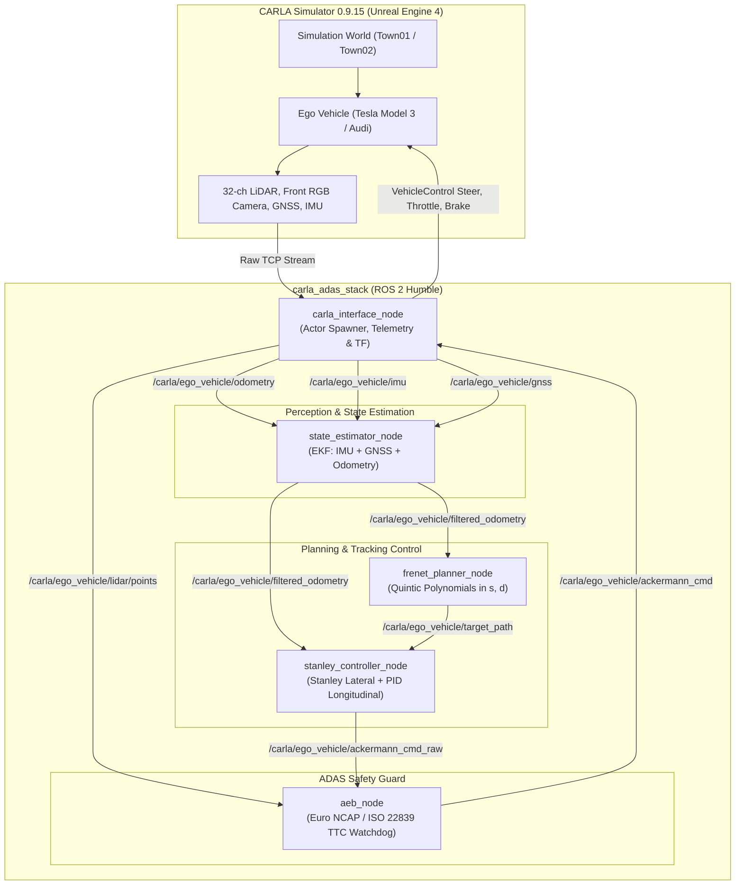

# CARLA ADAS & Autonomous Driving Stack (ROS 2 Humble)


A modular, production-grade **Autonomous Driving (AD) and Advanced Driver Assistance System (ADAS)** stack implemented in **ROS 2 Humble** and validated in the **CARLA Simulator (0.9.15)**.

Designed for automotive software engineering and autonomous systems architectures (e.g. BMW, CARIAD, Mobileye).

---

## Architecture Overview



---

## Core Modules & Mathematical Principles

### 1. Stanley Lateral Tracking Controller (`stanley_controller_node`)
Implements the Stanford DARPA Grand Challenge lateral path tracking law for Ackermann vehicles:
$$\delta(t) = \psi_e(t) + \arctan\left(\frac{k \cdot e_{ct}(t)}{v(t) + \epsilon}\right)$$
* **Heading Error $\psi_e$:** $\psi_e = \text{wrap\_to\_pi}(\psi_{path} - \psi_{vehicle})$.
* **Cross-Track Error $e_{ct}$:** Signed orthogonal distance from the front axle center $(x_f, y_f)$ to the nearest reference path segment.
* **Curvature-Adaptive Longitudinal Speed:** Dynamically throttles down in sharp corners and accelerates on straights:
  $$v_{target} = v_{max} \cdot \left(1.0 - 0.6 \frac{|\delta|}{\delta_{max}}\right)$$

### 2. Euro NCAP Notbremsassistent / AEB (`aeb_node`)
Compliant with **Euro NCAP** and **ISO 22839**:
* Filters 3D LiDAR point clouds inside the dynamic vehicle width corridor.
* Computes **Time-to-Collision (TTC)** against the nearest obstacle:
  $$TTC = \frac{d_{obstacle}}{v_{rel}}$$
* **Safety State Machine:**
  * **NORMAL (Green):** $TTC > 2.5\,\text{s}$ – Planner commands executed without alteration.
  * **WARNING / FCW (Yellow):** $1.4\,\text{s} < TTC \le 2.5\,\text{s}$ – Forward Collision Warning active, speed reduction clamped.
  * **EMERGENCY BRAKE (Red):** $TTC \le 1.4\,\text{s}$ or $d \le 4.0\,\text{m}$ – Immediate full brake override (`brake = 1.0`, `acceleration = -8.0 m/s²`).

### 3. Frenet Frame Local Trajectory Planner (`frenet_planner_node`)
Implements optimal quintic polynomial trajectory generation (Werling et al.):
* **Frenet Frame Coordinates:**
  * $s$: Longitudinal arc length along road reference line.
  * $d$: Lateral offset from road center line ($d = 0$ center, $d = +3.5\,\text{m}$ overtaking lane).
* Jerk-optimal polynomial formulation:
  $$d(t) = a_0 + a_1 t + a_2 t^2 + a_3 t^3 + a_4 t^4 + a_5 t^5$$
* Smooth lane transitions for dynamic obstacle avoidance without sudden steering spikes.

### 4. EKF State Estimator (`state_estimator_node`)
Fuses high-frequency IMU angular rate ($\omega_z$) and acceleration with GNSS fixes:
* State Vector: $\mathbf{x} = [x, y, \psi, v]^T$
* Covariance Propagation: $\mathbf{P}_{k|k-1} = \mathbf{F} \mathbf{P}_{k-1} \mathbf{F}^T + \mathbf{Q} \Delta t$
* Measurement Update on GNSS Fix: $\mathbf{K} = \mathbf{P} \mathbf{H}^T (\mathbf{H} \mathbf{P} \mathbf{H}^T + \mathbf{R})^{-1}$

---

## Quick Start Guide

### 1. Start CARLA Simulator (Host)
Launch the CARLA 0.9.15 server in GPU-accelerated low-quality mode:
```bash
./tools/start_carla.sh
```
*(Use `./tools/start_carla.sh --offscreen` for headless mode).*

### 2. Build the ROS 2 Stack
Inside the ROS 2 Humble workspace:
```bash
colcon build --packages-select carla_adas_stack
source install/setup.bash
```

### 3. Launch Full Autonomous Driving Stack
```bash
ros2 launch carla_adas_stack carla_adas.launch.py
```

### 4. Visualization in RViz2
```bash
rviz2 -d $(ros2 pkg prefix carla_adas_stack)/share/carla_adas_stack/rviz/adas_view.rviz
```

---

## ROS 2 Topic Interface

| Topic | Type | Description |
|---|---|---|
| `/carla/ego_vehicle/odometry` | `nav_msgs/msg/Odometry` | Raw ground-truth odometry from CARLA |
| `/carla/ego_vehicle/filtered_odometry` | `nav_msgs/msg/Odometry` | EKF-fused pose and velocity |
| `/carla/ego_vehicle/camera/image_raw` | `sensor_msgs/msg/Image` | Front windshield RGB camera (800x600, 30 Hz) |
| `/carla/ego_vehicle/lidar/points` | `sensor_msgs/msg/PointCloud2` | 32-beam 3D LiDAR point cloud |
| `/carla/ego_vehicle/target_path` | `nav_msgs/msg/Path` | Frenet-generated smooth target path |
| `/carla/ego_vehicle/ackermann_cmd` | `ackermann_msgs/msg/AckermannDrive` | Supervised drive commands (speed & steering angle) |
| `/carla/ego_vehicle/aeb_status` | `std_msgs/msg/String` | Live JSON status: state, obstacle distance, ego speed, TTC |
| `/carla/ego_vehicle/aeb_marker` | `visualization_msgs/msg/Marker` | 3D colored safety box in RViz2 |
